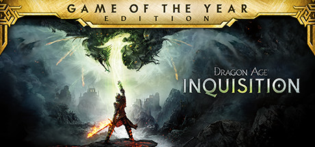

**Dragon Age: Inquisition is an epic open-world RPG where you lead the Inquisition against a demonic tear in the sky. Build your forces, romance companions, forge political alliances, and make decisions that shape the fate of Thedas in a massive single-player campaign.**

---

## 📖 About

Dragon Age: Inquisition is an epic open-world RPG where you lead the Inquisition against a demonic tear in the sky. Build your forces, romance companions, forge political alliances, and make decisions that shape the fate of Thedas in a massive single-player campaign.

## ⚠️ Problems Without Trainer

| Problem | Status |
|---------|--------|
| **Fetch Quest Padding** — War table operations and area collectibles bloat the runtime | ✅ Solved |
| **Combat Pacing** — Tactical mode is clunky; real-time is chaotic without micromanagement | ✅ Solved |
| **Crafting Grind** — Best gear requires specific rare material farming | ✅ Solved |
| **Load Times** — Frequent zoning creates jarring long loading screens | ✅ Solved |

## ✅ Solution

The **Dragon Age: Inquisition Trainer** solves all these issues by giving you complete control over the game.

## 🎯 Full Feature List

- Unlimited Resources
- God Mode / Invincibility
- Instant Skill Cooldown
- One-Hit Kill
- Freeze Game Timer
- Unlock All Items & Achievements
- Custom Speed Multiplier
- Save State Anywhere

## 🚀 Quick Start

1. **Disable Windows Defender** temporarily (trainer may trigger false positive)
2. Download the trainer from the button above
3. Launch Dragon Age: Inquisition
4. Run the trainer as Administrator
5. Activate desired cheats with hotkeys

## 💎 Free vs Paid

| Feature | Free | Pro |
|---------|------|-----|
| Basic God Mode | ✅ | ✅ |
| Unlimited Resources | ✅ | ✅ |
| All Advanced Cheats | ❌ | ✅ |
| Auto-Updates | ❌ | ✅ |
| Priority Support | ❌ | ✅ |

## 💻 Requirements

- Windows 10/11 (64-bit)
- Dragon Age: Inquisition (any version)
- .NET Framework 4.8+
- DirectX 11+

## 🍎 macOS

macOS users can use our alternative tool:

## ⚖️ Legal

This trainer is for educational and single-player use only. Use responsibly.

---

